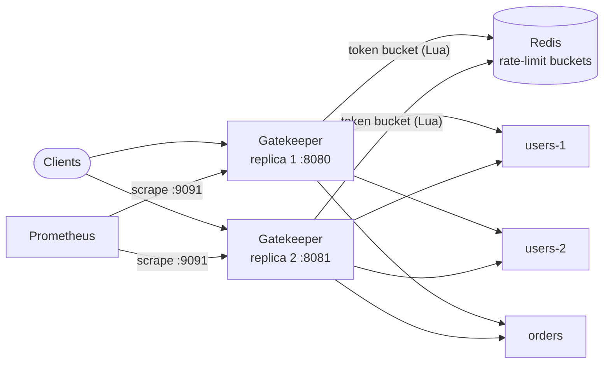

# Gatekeeper

An HTTP API gateway, written in Go: one entry point in front of several
backend services that routes requests, spreads load across healthy
instances, rate-limits clients, survives backend failures, and shows what it
is doing through metrics.

> **Status:** Milestones 0-5 of 7. It routes requests from a config file,
> spreads them across a backend's healthy instances, rate-limits each client
> with a limit shared by every gateway replica, retries safely, stops
> sending traffic to a failing backend, and exports Prometheus metrics. The
> load test is planned, not built.

## Status

| # | Milestone | Status |
|---|-----------|--------|
| 0 | Skeleton: Go module, CI, `/healthz`, graceful shutdown, distroless image, Compose | Built; waiting on CI |
| 1 | Routing: config file, method + path-pattern matching, reverse proxy, request IDs, timeouts | Built; waiting on CI |
| 2 | Load balancing, active health checks, passive failure detection | Built; waiting on CI |
| 3 | Rate limiting: token bucket per client, shared across replicas through Redis | Built; waiting on CI |
| 4 | Resilience: circuit breakers, retries for idempotent requests, body limits | Built; waiting on CI |
| 5 | Observability: Prometheus metrics, JSON logs | Built; waiting on CI |
| 6 | Load test: gateway overhead, throughput, rate-limit accuracy under load | Tooling built; no results yet |
| 7 | Architecture diagram, design decisions, benchmarks | Diagram, decisions and failures written; benchmarks wait on Milestone 6 |

## Quickstart

Needs Docker.

```bash
docker compose up --build --detach --wait
curl http://localhost:8080/users/42          # routed to the "users" backend
curl -X DELETE http://localhost:8080/api/orders/7   # to "orders", as /orders/7
docker compose down
```

Compose runs two gateway replicas (8080 and 8081) sharing a rate limit
through Redis, scraped by Prometheus (<http://127.0.0.1:9090>), in front of
test backends (all `cmd/echo`, which answers with
a JSON description of what reached it): `users` with two instances, and
`orders`, using `config/gatekeeper.json`.

## Configuration

```json
{
  "default_timeout": "5s",
  "backends": {
    "users": {
      "urls": ["http://users-1:9000", "http://users-2:9000"],
      "health_check": {"path": "/healthz", "interval": "1s", "unhealthy_after": 2, "healthy_after": 2},
      "eject_after": 3,
      "eject_for": "10s"
    },
    "users-strict": {"url": "http://users-1:9000", "timeout": "500ms"},
    "orders": {"url": "http://orders:9000"}
  },
  "routes": [
    {"match": "GET /users/{id}", "backend": "users"},
    {"match": "POST /users", "backend": "users"},
    {"match": "/api/orders/", "backend": "orders", "strip_prefix": "/api"},
    {"match": "GET /slow", "backend": "users-strict"}
  ],
  "max_body_bytes": 1048576,
  "rate_limit": {
    "requests_per_second": 5, "burst": 10,
    "key_header": "X-API-Key",
    "store": "redis", "redis_url": "redis://redis:6379/0",
    "on_store_error": "allow"
  }
}
```

- `match` is a Go `net/http` routing pattern: an optional method, a path
  with `{name}` wildcards, a trailing `{name...}`, or a trailing `/` for
  everything below. When two routes match, the more specific one wins
  (`GET /users/me` beats `GET /users/{id}`).
- `strip_prefix` is removed from the path before forwarding.
- `timeout` bounds the whole exchange with that backend.
- `url` for one instance or `urls` for several (all with the same path);
  `health_check` and `eject_after` / `eject_for` are explained under
  [Load balancing](#load-balancing); `retries` (default 1) and
  `circuit_breaker` under [Resilience](#resilience).
- `max_body_bytes` (default 10 MiB) caps request bodies.
- Unknown fields, unknown backends, non-HTTP URLs, non-positive timeouts and
  conflicting routes all stop the gateway at startup, with the file and the
  problem named.

## Architecture



Inside one gateway, a request passes through, in order:

```
request id -> access log + metrics -> router (most specific pattern)
  -> route label -> rate limiter -> body size limit -> circuit breaker
  -> pick a healthy instance -> retrying transport -> backend
```

The replicas share nothing but Redis: each keeps its own view of instance
health and its own circuit breakers, and only the rate limit, which must be
one limit per client rather than one per replica, lives in Redis.

## How a request is handled

1. It gets a request id: the caller's `X-Request-ID` if it is short and
   plain, otherwise a new random one.
2. The most specific matching route picks the backend. No match: JSON `404`.
   The path matches but the method does not: `405` with an `Allow` header.
3. The request is forwarded with `X-Forwarded-For`, `-Host`, `-Proto` and the
   request id, within the backend's timeout.
4. The answer goes back with `X-Request-ID` (exactly once, even if the
   backend echoes it). An unreachable backend gives `502`; one that does not
   answer in time gives `504` at the timeout.
5. One JSON access-log line: request id, method, path (without the query
   string, which may hold secrets), status, duration, bytes, route, backend,
   and the error if there was one.

The connection pool keeps up to 256 idle connections per backend. Go's
default is 2, which would make a busy proxy open and close a connection for
most requests.

**A bug found while building it.** A catch-all `/` route, added to answer
unmatched paths with a JSON 404, also caught requests whose path matched a
route but whose method did not, so every `405` became a `404`. `ServeMux`
only answers 405 when no pattern matches the path under any method. The
fallback now asks the router which methods would match, and answers 405
with `Allow` when some would.

## Load balancing

A backend's requests go round-robin to its healthy instances. Two signals
decide what "healthy" means:

- **Active health checks** (if `health_check` is set): every `interval`, the
  gateway requests `path` on each instance. An instance is marked down after
  `unhealthy_after` failed checks in a row and up again after `healthy_after`
  passes, so one slow check does not flip it.
- **Passive detection** (always): a request that fails to connect, times
  out, or gets a `503` counts against its instance; after `eject_after` in a
  row, the instance sits out for `eject_for`. Other 5xx answers do not count:
  a `500` is about that one request, not the instance.

If every instance looks unhealthy, the gateway sends traffic to all of them
anyway ("fail open", like Envoy's panic mode). A health check that is wrong,
say a broken `/healthz`, should not turn into a total outage; if the
instances really are down, requests fail with `502` either way.

Measured in the tests: with one of two instances dead and no health checks,
exactly `eject_after` requests fail (2 of 40) before passive detection takes
it out; the rest succeed. With health checks, the smoke test stops `users-2`,
and after 3 s all requests go to `users-1` with none failing; restarted, it
is back in rotation. That was before retries (Milestone 4); with them, the
smoke test now sees no failures at all when an instance stops.

**A bug caught before it shipped.** The health checks run beside the server
and must stop with it. The first version waited for them in a `defer`
registered after the signal handler's `stop()`; deferred calls run in
reverse order, so on a startup failure it would have waited for checks that
only stop when `stop()` runs, and hung. It now cancels the checks itself
before waiting.

## Rate limiting

Each client gets a token bucket: up to `burst` requests at once, refilled at
`requests_per_second`. A refused request gets `429` with `Retry-After` (whole
seconds, rounded up); every limited response carries `X-RateLimit-Limit` and
`X-RateLimit-Remaining`. Only proxied routes are limited; `/healthz` and
404s are not.

- **Who is a client.** The API key in `key_header` if the request has one,
  hashed (keys never reach Redis or the logs); otherwise the connection's IP.
  `X-Forwarded-For` is not trusted, since any client can set it.
- **Fractional tokens.** At 10 per second, half a token is back 50 ms after
  the bucket empties. A version that counted whole tokens and reset its
  clock on every request would starve a client that asks at exactly the
  refill rate; a test checks such a client is never refused.
- **`store: "memory"`** keeps buckets in the process, sweeping ones idle long
  enough to be full again, so memory does not grow with every client ever
  seen. Each replica has its own, so N replicas allow N times the limit.
- **`store: "redis"`** shares the buckets. One Lua script does the whole
  refill-and-take inside Redis, so two replicas cannot both spend the last
  token, and it uses Redis's clock, not the replicas'. Keys expire once a
  bucket would be full again. The token count is stored as a string: Lua
  numbers returned to Redis are truncated to integers.
- **If Redis fails**, `on_store_error` decides: `allow` (the default: the
  limiter is protection, and a Redis outage should not take the API down)
  or `deny` (503). After a failure the limiter skips Redis for 1 s, and logs
  the outage at most every 5 s.

Measured: in the smoke test, 60 requests with one key, alternating between
the two replicas as fast as they would go (0.1 s), got **10 through and 50
refused**: exactly the burst, once, not once per replica. With Redis
stopped, requests went through. The same Lua script runs against a real
Redis in CI, with two clients as two replicas taking from one bucket at
once.

**A bug found while building it.** The first fail-open path took about
**1.7 s per request** while Redis was down: go-redis retries a failed
command 3 times and a failed dial 5 times, with backoff, by default. Failing
open but slowly is close to failing. The limiter's client now has retries
off (`MaxRetries` is `-1`; `0` means "use the default"), plus the 1 s
skip, and a test requires each request during an outage to finish in under
300 ms. go-redis also printed its own plain-text log lines; they now go
through the gateway's JSON logger.

## Resilience

**Retries, to a different instance, only when safe.** A request is retried
(up to the backend's `retries`) when its instance fails to connect, times
out or answers `503`, and only if:

- it has no body (a body cannot be sent twice), and
- its method is safe (`GET`, `HEAD`, `OPTIONS`), or the connection never
  opened, so the backend cannot have seen it. A bodyless `POST` whose
  connection was refused is retried; one that got a `503` is not.

All attempts share the backend's one timeout.

**A retry budget.** Retries may add at most 20% to a backend's traffic over
the last 10 s, plus 3 per second. Without a cap, an outage doubles or
triples the load on a backend that is already failing (a retry storm).
Measured: 100 requests, every attempt failing, 5 retries allowed: the
backends saw **150 attempts**, exactly the budget (100 + 20 + 3/s for 10 s),
instead of 600.

**A circuit breaker per backend** (`circuit_breaker`). When at least
`min_requests` requests in the last 10 s have finished and `failure_ratio`
of them failed (connection errors, timeouts, 503s, after retries), it opens:
requests get an immediate `503` with `Retry-After` instead of each waiting
out the timeout. After `open_for`, one probe goes through: success closes
the circuit, failure reopens it. This is separate from ejecting a bad
instance (the balancer's job); it is for a whole backend failing. Measured:
20 requests against an open circuit were refused in about 2 ms in total.

**Body size limit.** A declared `Content-Length` over `max_body_bytes` gets
`413` before anything is read; a chunked body is cut off at the limit as it
streams, also `413`.

From the smoke test: stopping `users-2` and sending 10 requests at once
gave 10 successes (requests that hit it were retried on `users-1`);
stopping `orders` gave five `502`s and then `503`s from the open circuit;
bringing it back closed the circuit after one probe; a 2 MB upload got
`413`.

**A gap found while building it.** A `Config` built in code rather than
parsed from a file has a body limit of 0, and the first version took that
literally: every request with a body got `413`. An older test caught it.
Zero now means the default.

## Metrics

Prometheus metrics are served on a separate admin port
(`GATEKEEPER_ADMIN_LISTEN`, default `:9091`), not on the public one: they
name backends, instance addresses and error rates, which clients have no
business seeing, and a separate port can never clash with a configured
route.

| Metric | Labels | What |
|--------|--------|------|
| `gatekeeper_requests_total` | route, backend, code | requests handled |
| `gatekeeper_request_duration_seconds` | route, backend | latency histogram, 1 ms to 10 s |
| `gatekeeper_requests_in_flight` | | requests being handled now |
| `gatekeeper_upstream_attempts_total` | backend, outcome | tries at an instance, retries included |
| `gatekeeper_retries_total` | backend | retries sent to another instance |
| `gatekeeper_rate_limit_decisions_total` | decision | allowed, refused, store_error |
| `gatekeeper_circuit_state` | backend | 0 closed, 1 open, 2 half-open |
| `gatekeeper_instance_healthy` | backend, instance | 1 if it takes traffic |
| `gatekeeper_build_info` | version | always 1 |

plus the Go runtime and process metrics.

- **The route label is the configured pattern** (`GET /users/{id}`), never
  the request path. A path label would add a time series for every user id
  ever requested, which is the usual way to run a Prometheus server out of
  memory. Requests that match no route are labelled `unmatched`. A test
  sends three different ids and checks they produce one series.
- **Circuit state and instance health are read at scrape time** from the
  breaker and the pool themselves, so they cannot drift from what the
  gateway is doing.
- **A private registry,** not Prometheus's global one, so each gateway (and
  each test) has its own metrics.

The smoke test checks that metrics are on 9091 and not on 8080, and that
Prometheus has scraped both replicas and recorded the run's 429s and the
`orders` circuit closing again.

**A bug the metrics tests found.** Requests refused by the rate limiter
were counted as `unmatched`, and logged without their route: the route was
recorded inside the proxy handler, which a refused request never reaches.
It is now recorded first, before the limiter, the body limit or the
breaker can turn the request away.

## Load testing

`bench/run.py` measures the gateway with `cmd/loadgen`, a small open-loop
load generator: request *i* is due at start + *i*/rate whether or not
earlier ones have finished, and its latency counts from when it was due. A
closed-loop tool (send, wait, send) slows down when the server does and so
under-reports exactly the bad latency (coordinated omission); a test checks
that loadgen reports the queueing a slow server causes. It runs inside the
Compose network, so Docker Desktop's port forwarding is not part of the
measurement.

It compares three targets at 500, 2,000 and 4,000 requests per second: the
echo backend directly, the gateway, and the gateway with the Redis rate
limiter on (at a limit far above the load, so only its cost is added). Then
a rate-limit accuracy test: one key at 300 requests/s for 10 s, alternating
between both replicas, against 50/s with a burst of 50, which should let
exactly 550 through. Every configuration runs in a forward and a reverse
pass; the runner refuses to start while the host is swapping and marks any
run during which it swapped in.

```bash
python3 bench/run.py      # about 10 minutes
```

**Status: no results yet.** A short trial confirmed the runner works, but it
ran on a laptop that was swapping, so its numbers are not reported. The
measurement waits for a quiet machine.

## Design decisions

| Decision | Why | Cost, or what would change it |
|----------|-----|-------------------------------|
| Routes on Go's `net/http` patterns | Matching and "most specific wins" are the standard library's, documented and tested there | Only what ServeMux patterns can express; no regex routes |
| Conflicting routes are a startup error | ServeMux panics on them; recovering that panic turns a bad config into a clear message | Relies on recovering a library panic |
| One shared transport, 256 idle connections per backend | Go's default of 2 makes a busy proxy reconnect for most requests | More open sockets per backend |
| `X-Request-ID` set as headers go out | A backend that echoes it does not produce two copies | The id is fixed before the backend answers |
| Liveness only on `/healthz` | Docker restarts on a failed check; that would not fix a backend outage | No readiness endpoint yet |
| Static binary in distroless, self health check | ~16 MB, no shell; `gatekeeper healthcheck` replaces curl | Debugging inside the container is harder |
| Round robin over healthy instances; fail open when none is | A wrong health signal should degrade, not refuse everything | With every instance truly down, requests still try them (and get 502) |
| Active checks plus passive ejection; 503 counts, 500 does not | Checks catch idle failures; real traffic catches them faster; a 500 is about one request | Two mechanisms and their thresholds to tune |
| Fractional token bucket | A client at exactly the refill rate is never starved | Floating point in the bucket |
| Redis Lua script on Redis's clock | Atomic across replicas; immune to their clock drift | Every limited request is a Redis round trip |
| Client = hashed API key, else connection IP | Keys never stored or logged; `X-Forwarded-For` is forgeable | Behind a load balancer every client shares its IP until trusted proxies are configured |
| Rate limiter fails open, fast | A limiter outage should not become an API outage | During a Redis outage there is no limit (configurable to fail closed) |
| Retries only when safe, to another instance, within a budget | Hides dead instances without replaying bodies or causing retry storms | Requests with bodies are never retried |
| Circuit breaker per backend, separate from instance ejection | Whole-backend failure needs a different answer (fail fast) than one bad instance | Another state machine per backend |
| Metrics on an admin port; route patterns as labels | Internals stay private; series count stays bounded | Two ports to run and protect |
| Open-loop load generator inside the Compose network | No coordinated omission; no Docker Desktop port forwarding in the numbers | Load generator and gateway share the laptop's CPUs |

## Failures found while building it

Each was caught by a test, `-race`, or reading the code, fixed, and covered
by a test where one could be written:

1. **A catch-all 404 turned every 405 into a 404.** ServeMux answers 405
   only when no pattern matches the path; the JSON fallback matched
   everything. It now asks the router which methods would match.
   (Milestone 1, a test.)
2. **A shutdown that could hang.** `main` waited for the health checks in a
   `defer` that ran before the one cancelling them, so a startup error would
   have hung the process. It now cancels, then waits. (Milestone 2, found
   reading the code.)
3. **A data race in a test.** The health checker wrote log lines into a
   `bytes.Buffer` that the test was reading; `-race` reported it. Tests now
   use a locked buffer. (Milestone 2.)
4. **Failing open took 1.7 s per request.** go-redis retries a failed
   command 3 times and a dial 5 times by default, so with Redis down every
   request waited before going through. Retries are off (`-1`, not `0`),
   with a 1 s store skip and a test bounding each request at 300 ms.
   (Milestone 3, a test.)
5. **Every request with a body got 413.** A `Config` built in code had a body
   limit of 0, taken literally. Zero now means the default. (Milestone 4, an
   older test.)
6. **Rate-limited requests were counted as `unmatched`.** The route was
   recorded inside the proxy handler, which a refused request never reaches,
   so metrics and logs lost it. Route labels are now applied first.
   (Milestone 5, a metrics test.)

## The server itself

- `GET /healthz` is liveness only: the process is up and serving. It checks
  nothing else, so a backend outage never makes Docker restart the gateway.
- **Graceful shutdown.** On SIGTERM (what `docker stop` sends) the gateway
  stops accepting connections and lets requests in flight finish, up to
  `GATEKEEPER_SHUTDOWN_TIMEOUT` (default 10 s), then exits 0. Tested both
  ways: a slow request finishes; a stuck one is cut off at the timeout.
- **About 16 MB per image** (gateway and echo): a static binary in a
  distroless base, no shell or package manager, running as a non-root user. With no curl inside, the
  container health check runs the binary itself (`gatekeeper healthcheck`).
- JSON logs on stdout (`log/slog`), including go-redis's own messages.
- `ReadHeaderTimeout` is set, so a client that trickles headers cannot hold a
  connection open indefinitely.

## Development

Needs Go 1.27.

```bash
make test        # go test -race ./...
make test-redis  # the rate limiter's Lua script against Compose's Redis
make lint    # gofmt and go vet
make smoke   # start the stack; check routing, ids, 404/405/502/504 and a clean SIGTERM stop
```

CI runs gofmt, vet, `go test -race` (with a Redis service, so the rate
limiter's integration test runs; without it the test skips locally and fails
in CI) and a build, then a Compose job that starts the stack and runs the
smoke test over real HTTP.

## License

MIT.
